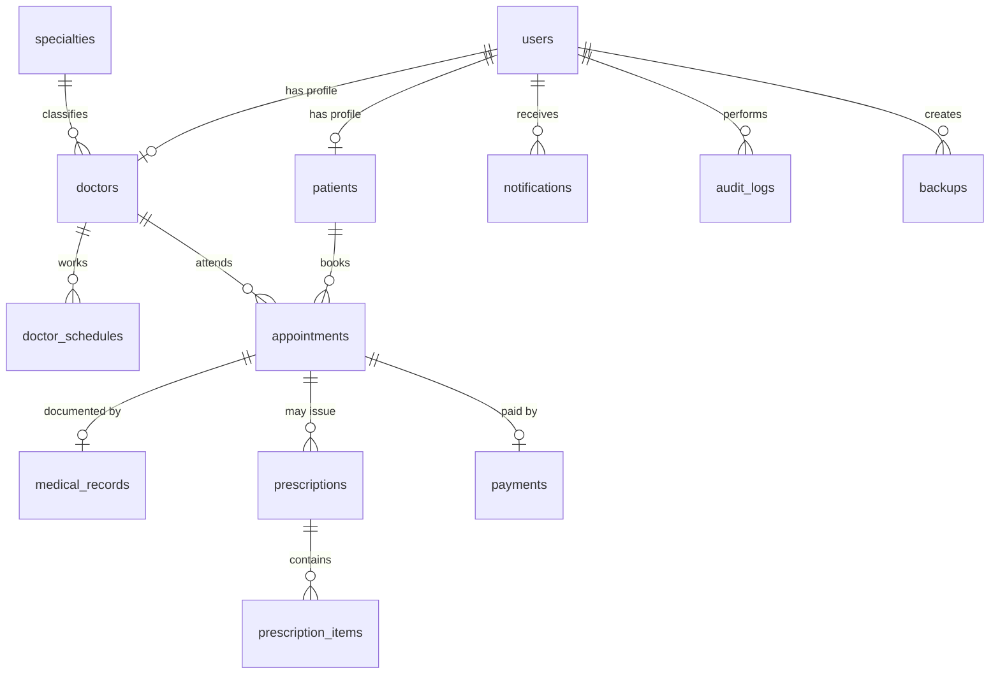

# MediCare Connect

**An integrated e-clinic appointment and patient-record management system**
Built with PHP 8 and MySQL/MariaDB, designed to run locally on XAMPP.

| | |
|---|---|
| **Version** | 1.0.0 |
| **Document date** | November 2026 |
| **Based on** | *Software Requirements Specification: MediCare Connect* v1.0.0 (October 2026) |
| **Course** | Software Engineering, SIIMT University |
| **Team** | Group of four students (see [section 19](#19-presentation-plan-4-presenters)) |
| **Lecturer** | *(add lecturer's name)* |

---

## Table of contents

1. [Project overview](#1-project-overview)
2. [Features](#2-features)
3. [Technology stack](#3-technology-stack)
4. [System architecture](#4-system-architecture)
5. [Installation (XAMPP)](#5-installation-xampp)
6. [Configuration](#6-configuration)
7. [Demo accounts and demo data](#7-demo-accounts-and-demo-data)
8. [User guide by role](#8-user-guide-by-role)
9. [Database design](#9-database-design)
10. [Business rules](#10-business-rules)
11. [Security](#11-security)
12. [Automated jobs (reminders and backups)](#12-automated-jobs-reminders-and-backups)
13. [Project structure](#13-project-structure)
14. [SRS traceability matrix](#14-srs-traceability-matrix)
15. [Simulated components and going to production](#15-simulated-components-and-going-to-production)
16. [Testing](#16-testing)
17. [Troubleshooting](#17-troubleshooting)
18. [Known limitations and future work](#18-known-limitations-and-future-work)
19. [Presentation plan (4 presenters)](#19-presentation-plan-4-presenters)

---

## 1. Project overview

### 1.1 Purpose
MediCare Connect digitises the day-to-day workflow of a clinic: patients register and book appointments online, reception manages arrivals through a live queue, doctors record consultations and issue electronic prescriptions, and administrators control access, view reports and keep encrypted backups.

### 1.2 Scope
**In scope** (from SRS section 1.2): web-based patient registration, doctor schedule management, electronic medical record (EMR) maintenance, automated notifications and payment processing.
**Out of scope:** emergency triage and physical pharmacy inventory.

### 1.3 Aim and objectives
To modernise clinical administrative workflows by:
- reducing patient waiting time (the **Reports** page measures the average wait from check-in to start of consultation so the improvement can be tracked);
- centralising medical records behind role-based access control;
- eliminating manual record errors through structured, validated data entry.

### 1.4 Users
| Role | Who | Main goals |
|---|---|---|
| **Patient** | Registered clinic patient | Book visits, follow the queue, view records and prescriptions |
| **Doctor** | Clinic physician | See today's queue, run consultations, issue e-prescriptions |
| **Staff** | Reception | Check patients in, manage the queue, book on behalf of walk-ins |
| **Admin** | Super administrator | Manage users and roles, reports, audit log, backups |

---

## 2. Features

### Patient module (SRS 3.1)
- Registration with strong-password rules and **email verification**
- **Multi-factor login**: password followed by a one-time emailed code (can be switched off per user in the profile)
- Profile with **medical history questionnaire** (allergies, chronic conditions, current medication, past surgeries, family history, smoking) and **emergency contact**
- **Doctor search** by specialty or name; slot picker showing only free times; booking in three clicks
- Appointment list with **cancel** (up to one hour before) and **pay now**
- **Simulated card payment** with receipt reference
- **Live queue position** and estimated wait on the dashboard (refreshes every 10 seconds)
- **Records page** showing visit history, vitals, diagnosis, notes and e-prescriptions (printable)
- In-app alerts, plus email and SMS copies (simulated locally)

### Doctor module (SRS 3.2)
- Dashboard with today's patients ordered by queue, allergy warnings, and live refresh
- **Call in** the next waiting patient
- Consultation screen: patient summary, vitals, symptoms, diagnosis, notes
- **E-prescription** with any number of medication lines; save draft or complete
- "My patients" list and visit history, limited to patients the doctor has treated
- Weekly **schedule manager** (sessions and slot length, overlap check)

### Reception module (SRS 3.2)
- **Live queue board** per doctor with Expected / Waiting / In consultation / Completed counters
- Check-in (assigns the next queue number), no-show, cancel
- Appointment list filtered by date, status and patient name
- Walk-in booking on behalf of an existing patient

### Admin module (SRS 3.2 and 3.3)
- **Users and roles (RBAC):** create staff, doctor or admin accounts, change roles, enable/disable, reset passwords
- **Reports:** appointments by status, per day, per doctor (completed, cancelled, no-show, average wait, revenue); CSV export and print
- **Audit log** of sign-ins, record access, role changes, backups and more, with filter and pagination
- **Outbox** of every email and SMS the system sent
- **Reminder job** button (24-hour reminders)
- **Encrypted database backups** (AES-256-GCM) with download

---

## 3. Technology stack

| Layer | Technology |
|---|---|
| Language | PHP 8.x (developed and tested on 8.3) |
| Database | MySQL / MariaDB (XAMPP default), accessed through **PDO** with prepared statements |
| Web server | Apache (XAMPP) |
| Front end | Server-rendered HTML, one hand-written CSS file, small vanilla JavaScript file (no frameworks, no CDN, works offline) |
| Encryption | PHP OpenSSL (AES-256-GCM for backups), `password_hash` bcrypt for passwords |
| Required PHP extensions | `pdo_mysql`, `mbstring`, `openssl` (all enabled in XAMPP by default) |

**Why not React / AWS / Docker as in the SRS recommendations?** The brief for this build was PHP and SQL on XAMPP. Those items are listed in [section 15](#15-simulated-components-and-going-to-production).

---

## 4. System architecture

### 4.1 Overview
A classic server-rendered, multi-page PHP application. Each page is a PHP script that loads a shared bootstrap, enforces access control, handles any form submission, then renders HTML.

```
 Browser ──HTTP──▶ Apache + PHP ──PDO──▶ MySQL (medicare_connect)
                      │
                      ├── includes/   shared code (auth, helpers, notify, backup, layout)
                      ├── patient/ doctor/ staff/ admin/   role modules
                      ├── cron/       command-line jobs (reminders, backups)
                      └── storage/    encrypted backup files (not web-accessible)
```

### 4.2 Request lifecycle
1. The page requires `includes/bootstrap.php`, which loads config, database, helpers, auth and notification code.
2. `includes/auth.php` starts a hardened session and verifies the **CSRF token** on every POST.
3. The page calls `require_role(...)`. Wrong role gives a **403** and an audit-log entry; no session redirects to the login page.
4. Form handling runs (always before any HTML output so redirects work).
5. `includes/header.php` renders the role-specific menu, the page renders, `includes/footer.php` closes it.

### 4.3 Key components
| File | Responsibility |
|---|---|
| `includes/db.php` | PDO connection and helper functions `q()`, `q_all()`, `q_one()`, `q_val()` |
| `includes/auth.php` | Sessions, login (password then MFA), lockout, `require_role()` (RBAC), logout |
| `includes/helpers.php` | Escaping, CSRF, flash messages, audit logging, `available_slots()`, `book_slot()`, reception actions |
| `includes/notify.php` | `notify_user()` (in-app + email + SMS), `run_reminder_job()`, dispatcher stubs for SendGrid/Twilio |
| `includes/backup.php` | Pure-PHP database dump, AES-256-GCM encrypt/decrypt |
| `assets/js/app.js` | 10-second live refresh of marked regions, confirm dialogs, "add medication" row |

### 4.4 Appointment lifecycle

```
              book                check-in            call in            complete
 (none) ────────────▶ booked ─────────────▶ checked_in ─────────▶ in_consultation ─────────▶ completed
                        │                       │
                        ├── cancel ─────────────┤──▶ cancelled   (slot is released)
                        └── no-show ────────────┘──▶ no_show     (slot is released)
```

---

## 5. Installation (XAMPP)

### 5.1 Requirements
- Windows 10/11 (macOS and Linux also work with XAMPP/LAMP)
- **XAMPP** with PHP 8.0 or newer, Apache and MySQL/MariaDB
- A modern browser (Chrome, Edge, Firefox)
- On Windows, the **Microsoft Visual C++ Redistributable 2015-2022** must be up to date (see [troubleshooting](#17-troubleshooting))

### 5.2 Steps
1. **Start XAMPP** (run it as Administrator) and click **Start** next to **Apache** and **MySQL**. Both should turn green.
2. **Copy the project.** Put the whole `medicare_connect` folder in `C:\xampp\htdocs\` so you end up with `C:\xampp\htdocs\medicare_connect\index.php`.
3. **Create the database.** Open **http://localhost/phpmyadmin**, click **Import**, choose `database/medicare_connect.sql`, then click **Go**. This creates the `medicare_connect` database, 13 tables and the demo data.
   *Alternative (command line):* `C:\xampp\mysql\bin\mysql.exe -u root < C:\xampp\htdocs\medicare_connect\database\medicare_connect.sql`
4. **Check the connection settings** in `config/config.php` (defaults match a fresh XAMPP: user `root`, empty password).
5. **Open the app:** **http://localhost/medicare_connect/**
6. Sign in with a [demo account](#7-demo-accounts-and-demo-data).

> Re-importing the SQL file **wipes and recreates** all tables. Use it to reset the demo to its starting state.

### 5.3 Non-default port
If Apache runs on another port (for example 8080), use `http://localhost:8080/medicare_connect/`. The application detects its own URL path automatically.

---

## 6. Configuration

All settings are in `config/config.php`.

| Constant | Default | Meaning |
|---|---|---|
| `DB_HOST`, `DB_PORT` | `127.0.0.1`, `3306` | MySQL server address |
| `DB_NAME` | `medicare_connect` | Database name |
| `DB_USER`, `DB_PASS` | `root`, *(empty)* | MySQL credentials. If you set a MySQL root password, put it here |
| `APP_NAME` | `MediCare Connect` | Shown in the header and emails |
| `CURRENCY` | `GHS` | Currency label for fees and revenue |
| `DEMO_MODE` | `true` | Shows MFA codes and verification links on screen because local XAMPP cannot send email. Set `false` for real deployments |
| `BACKUP_KEY` | placeholder text | Secret from which the AES-256 backup key is derived. **Change it** before storing real backups, and keep it safe: without it a backup cannot be decrypted |
| `MFA_MINUTES` | `10` | Lifetime of a login code |
| `MAX_FAILED_LOGINS` | `5` | Failed passwords before lockout |
| `LOCK_MINUTES` | `5` | Lockout duration |
| Time zone | `Africa/Accra` | Set by `date_default_timezone_set()` at the end of the file |

---

## 7. Demo accounts and demo data

**Password for every demo account: `Password@123`**

| Role | Name | Email |
|---|---|---|
| Admin | System Administrator | `admin@medicare.test` |
| Staff (reception) | Abena Mensah | `staff@medicare.test` |
| Doctor (General Practice) | Dr. Kwame Boateng | `kwame@medicare.test` |
| Doctor (Pediatrics) | Dr. Efua Owusu | `efua@medicare.test` |
| Doctor (Cardiology) | Dr. Selorm Agbenyo | `selorm@medicare.test` |
| Patient | Ama Serwaa | `patient@medicare.test` |
| Patient | Kofi Asante | `kofi@medicare.test` |
| Patient | Yaw Darko | `yaw@medicare.test` |
| Patient | Akosua Frimpong | `akosua@medicare.test` |

**Login codes:** with `DEMO_MODE` on, the 6-digit code is displayed on the code page and also stored in **Admin > Outbox**.

**Seeded data (relative to the day you import):**
- two past completed visits with medical records, prescriptions and payments;
- two patients already **checked in** today for Dr. Boateng (the live queue);
- one booked appointment today for Dr. Owusu, and one tomorrow at 10:00 (used to demo the 24-hour reminder);
- schedules for all doctors: Monday to Saturday mornings (08:00-12:00) and Monday to Friday afternoons (14:00-17:00), 30-minute slots.

**Test payment card:** `4242 4242 4242 4242`, any future expiry (e.g. `12/29`), any 3-digit CVC.

---

## 8. User guide by role

### 8.1 Patient
1. **Register** at *Register*. Enter name, email, phone, password (8+ characters with upper-case, lower-case and a number).
2. **Verify email.** Open the link (in demo mode a "Click here to verify now" link appears on screen).
3. **Sign in**, enter the one-time code.
4. **Complete your profile** (*Profile*): medical history, emergency contact. You can also change your password and turn the email code on or off.
5. **Book** (*Book*): choose a specialty or search by name, click **View slots**, pick a date and time, add a reason, confirm. A confirmation alert, email and SMS are generated.
6. **Pay** from *Appointments > Pay now* using the test card.
7. **On the day:** after reception checks you in, the dashboard shows your queue number, how many people are ahead, and the estimated wait. When the doctor calls you it says **"It's your turn"**.
8. **After the visit:** *Records* shows the diagnosis, vitals, notes and prescription. Use **Print** for a paper copy.
9. **Cancel** from *Appointments* up to one hour before the visit (a paid appointment is marked refunded).

### 8.2 Reception staff
1. **Queue** shows today's appointments grouped by doctor. When a patient arrives, click **Check in**; they receive the next queue number and a notification.
2. Use **No-show** for patients who do not arrive (this releases the slot).
3. **Appointments** lets you look up any date, filter by status or name, check in, or cancel.
4. **Walk-in booking:** choose doctor and date, click **Show slots**, then choose the patient, a time and a reason.

### 8.3 Doctor
1. **Today** lists your patients. A red badge shows recorded allergies. Click **Call in** for the next waiting patient; the patient is notified and the consultation page opens.
2. In the **consultation** page review the patient summary, enter vitals, symptoms, diagnosis and notes, then add prescription lines (**+ Add medication**) and instructions.
3. **Save draft** keeps your work, **Complete consultation** closes the visit, publishes the record to the patient and notifies them.
4. **Patients** lets you search patients you have treated and open their history.
5. **My schedule** adds or removes weekly sessions and sets slot length. Overlaps are rejected; existing bookings are never deleted.

### 8.4 Administrator
- **Overview:** key numbers, recent activity, and **Run reminder job now**.
- **Users and roles:** filter users; change a user's role (patient/staff/admin); enable or disable accounts; generate a temporary password; create staff, doctor or admin accounts (a new doctor automatically gets a Monday-Friday morning schedule). You cannot change your own role or disable yourself.
- **Reports:** choose a date range, review the figures, **Export CSV** or **Print**.
- **Audit log:** filter by action prefix (for example `login`, `records`, `rbac`).
- **Outbox:** inspect every simulated email and SMS.
- **Backups:** **Create backup now**, download previous backups.

---

## 9. Database design

Database name: `medicare_connect` (utf8mb4, InnoDB, 13 tables, foreign keys enforced).

### 9.1 Entity-relationship diagram



### 9.2 Tables
| Table | Purpose | Notable columns |
|---|---|---|
| `users` | All accounts | `role` (patient/doctor/staff/admin), `password_hash` (bcrypt), `email_verified`, `verify_token`, `mfa_enabled`, `mfa_code_hash`, `mfa_expires`, `failed_attempts`, `locked_until`, `is_active` |
| `specialties` | Medical specialties | `name` (unique) |
| `patients` | Patient profile and medical history | `dob`, `gender`, `blood_group`, `allergies`, `chronic_conditions`, `current_medications`, `past_surgeries`, `family_history`, `smoker`, emergency contact fields |
| `doctors` | Doctor profile | `specialty_id`, `license_no`, `consultation_fee`, `room`, `bio` |
| `doctor_schedules` | Weekly working sessions | `weekday` (1=Mon..7=Sun), `start_time`, `end_time`, `slot_minutes` |
| `appointments` | Bookings and queue state | `appt_date`, `appt_time`, `status`, `queue_number`, `checked_in_at`, `started_at`, `completed_at`, `reminder_sent`, **`slot_key`** |
| `medical_records` | One EMR entry per completed visit | `blood_pressure`, `temperature`, `pulse`, `weight_kg`, `symptoms`, `diagnosis`, `notes` |
| `prescriptions` | Prescription header | `appointment_id`, `instructions`, `issued_at` |
| `prescription_items` | Medication lines | `medication`, `dosage`, `frequency`, `duration` |
| `payments` | Consultation fee payments | `amount`, `method`, `card_last4` (only last four digits), `reference`, `status` (paid/refunded) |
| `notifications` | In-app inbox **and** email/SMS outbox | `channel` (inapp/email/sms), `kind`, `subject`, `body`, `status`, `read_at` |
| `audit_logs` | Security and activity trail | `user_id`, `action`, `details`, `ip`, `created_at` |
| `backups` | Registry of backup files | `filename`, `size_bytes`, `created_by` |

### 9.3 Design notes
- **Double-booking prevention:** `appointments.slot_key` is a unique column holding `doctorId-date-time`. It is set to `NULL` when an appointment is cancelled or marked no-show, which frees the slot (MySQL allows many `NULL` values in a unique index). Two simultaneous bookings of the same slot cannot both succeed.
- **Queue numbers** are per doctor per day and assigned inside a transaction (`SELECT ... FOR UPDATE`).
- **One notifications table** serves both the patient inbox and the admin Outbox, separated by `channel`.

---

## 10. Business rules

| Rule | Value |
|---|---|
| Password policy | 8+ characters, with upper-case, lower-case and a digit |
| Login lockout | 5 wrong passwords lock the account for 5 minutes |
| Login code | 6 digits, valid 10 minutes, stored hashed |
| Booking window | Today up to 60 days ahead; past times are never offered |
| Slot generation | From the doctor's schedule, using each session's slot length, minus booked slots |
| Patient cancellation | Only while status is *booked* and at least 1 hour before the visit |
| Cancellation of a paid visit | Payment is marked *refunded* |
| Reminder | Sent once, for *booked* appointments starting within the next 24 hours |
| Queue estimate | People ahead of you multiplied by 15 minutes (an approximation) |
| Doctor record access | A doctor can open only patients they have an appointment with |
| Self-protection | An admin cannot disable or change the role of their own account |
| Doctor accounts | Created only through Admin > Add user (they need specialty and fee), so their role cannot be switched in the role dropdown |

---

## 11. Security

| Measure | Where |
|---|---|
| Bcrypt password hashing | `password_hash(..., PASSWORD_BCRYPT)` |
| Multi-factor login, hashed one-time codes | `includes/auth.php`, `mfa.php` |
| Role-Based Access Control on every protected page | `require_role()`; denials are audit-logged (`rbac.denied`) |
| CSRF protection on all POST forms | `csrf_field()` and `csrf_check()` (HTTP 419 on failure) |
| SQL injection protection | PDO prepared statements everywhere (`ATTR_EMULATE_PREPARES` off) |
| XSS protection | All output passes through `e()` (`htmlspecialchars`) |
| Session hardening | HttpOnly, SameSite=Lax cookie; session ID regenerated at login |
| Brute-force protection | Lockout after repeated failures |
| Audit trail | Sign-ins, failed attempts, record views, role changes, payments, backups |
| Encrypted backups | AES-256-GCM (authenticated encryption) |
| Card data | No full card number or CVC stored; only the last four digits |
| Web access blocked to internals | `.htaccess` deny rules on `config/`, `includes/`, `storage/`, `database/` |
| Least privilege | Doctors see only their own patients; patients see only their own data |

**Before any real use:** change `BACKUP_KEY`, set a MySQL root password and a dedicated database user, set `DEMO_MODE` to `false`, serve over HTTPS (TLS), and review the privacy-law obligations (HIPAA/GDPR-style rules, regional data residency) noted in SRS sections 4.2 and 6.

---

## 12. Automated jobs (reminders and backups)

Both jobs are plain PHP command-line scripts, so they can be scheduled with Windows Task Scheduler (or cron on Linux). They refuse to run from a browser.

| Job | Command | Suggested schedule |
|---|---|---|
| 24-hour reminders | `C:\xampp\php\php.exe C:\xampp\htdocs\medicare_connect\cron\send_reminders.php` | Every 30 minutes |
| Encrypted backup | `C:\xampp\php\php.exe C:\xampp\htdocs\medicare_connect\cron\backup.php` | Daily |

**Task Scheduler setup:** *Create Basic Task > Trigger (daily/repeat) > Action: Start a program* with the path to `php.exe` and the script as the argument.

**Manual triggers:** Admin > Overview > *Run reminder job now*, and Admin > Backups > *Create backup now*.

**Restoring a backup**
1. `C:\xampp\php\php.exe cron\decrypt_backup.php storage\backups\FILE.sql.enc > restore.sql`
2. Import `restore.sql` in phpMyAdmin (or with `mysql -u root medicare_connect < restore.sql`).

The decryption uses the `BACKUP_KEY` that was active when the backup was made.

---

## 13. Project structure

```
medicare_connect/
├── index.php              public landing page
├── login.php  mfa.php  register.php  verify.php  logout.php
├── config/
│   └── config.php         settings
├── database/
│   └── medicare_connect.sql   schema + demo data
├── includes/              shared code
│   ├── bootstrap.php  db.php  auth.php  helpers.php
│   ├── notify.php  backup.php  header.php  footer.php
├── patient/               dashboard, book, appointments, pay, profile, records, notifications
├── doctor/                dashboard, consult, patients, schedule
├── staff/                 queue, appointments, walkin
├── admin/                 index, users, reports, logs, outbox, backup
├── cron/                  send_reminders, backup, decrypt_backup (CLI only)
├── assets/                css/style.css, js/app.js
└── storage/backups/       encrypted backup files (blocked from the web)
```
About 1,700 lines of PHP across 40 scripts.

---

## 14. SRS traceability matrix

| SRS ref | Requirement | Status | Implemented in |
|---|---|---|---|
| 1.2 | Patient registration, schedules, EMR, notifications, payments | Done | Whole system |
| 1.3 | Reduce waiting time; centralise records; remove manual errors | Supported | Queue, average-wait report, validated forms, EMR |
| 3.1 | Secure registration, email verification, multi-factor login | Done | `register.php`, `verify.php`, `login.php`, `mfa.php` |
| 3.1 | Update medical history questionnaire and emergency contacts | Done | `patient/profile.php` |
| 3.1 | Search doctors by specialty, view slots, schedule visits | Done | `patient/book.php` |
| 3.1 | Confirmations and automated reminders | Done (simulated delivery) | `includes/notify.php` |
| 3.2 | Doctor dashboard with daily schedule | Done | `doctor/dashboard.php`, `doctor/schedule.php` |
| 3.2 | Issue digital e-prescriptions | Done | `doctor/consult.php` |
| 3.2 | Real-time queue and consultation status | Done (10-second polling) | `staff/queue.php`, dashboards |
| 3.2 | RBAC, user logs, report generation | Done | `admin/users.php`, `admin/logs.php`, `admin/reports.php` |
| 3.3 | Reminders 24 hours before consultations | Done | `run_reminder_job()`, `cron/send_reminders.php` |
| 3.3 | Daily backups, AES-256 at rest | Done | `includes/backup.php`, `cron/backup.php` |
| 3.3 | TLS 1.3 in transit | Deployment | Configure HTTPS on the web server |
| 4.1 | Under 2 s response, 500+ concurrent users | Not measured | Needs load testing on production infrastructure |
| 4.2 | Bcrypt, RBAC, HIPAA/GDPR-aligned practices | Done (technical controls) | See [section 11](#11-security) |
| 4.3 | WCAG 2.1 AA, key flows within 3 clicks | Designed for | Labels, skip link, focus outlines, contrast, responsive layout; booking is 3 steps |
| 4.4 | 99.9% uptime, failover, replication | Deployment | Infrastructure concern |
| 5.1 | React.js front end | Not used | Server-rendered PHP chosen for XAMPP |
| 5.2 | AWS EC2/RDS hosting | Not used | Runs locally |
| 5.3 | Twilio/SendGrid, Stripe/PayPal | Simulated | See next section |
| 6 | Internet required, restricted offline sync | Consistent | No offline mode |
| 7 | Agile, Docker, CI/CD | Process | Not part of the code deliverable |

---

## 15. Simulated components and going to production

| Area | In this build | To make it real |
|---|---|---|
| **Email** (SendGrid) | Message is saved to the Outbox; code and links appear on screen in demo mode | Implement `dispatch_email()` in `includes/notify.php` with the SendGrid API; set `DEMO_MODE` to `false` |
| **SMS** (Twilio) | Saved to the Outbox | Implement `dispatch_sms()` with the Twilio API |
| **Payments** (Stripe/PayPal) | Fake card form with a Luhn check; stores last four digits and a reference | Replace the block in `patient/pay.php` with the gateway SDK/hosted checkout; never handle raw card numbers yourself |
| **TLS** | Plain HTTP on localhost | Enable HTTPS (TLS 1.2/1.3) on the web server or load balancer |
| **Real-time queue** | Pages poll every 10 seconds | WebSockets or server-sent events if instant updates are required |
| **Scaling and failover** | Single Apache and MySQL | Cloud hosting, database replication, load balancer, container deployment |

---

## 16. Testing

### 16.1 What was verified
The application was smoke-tested end to end on PHP 8.3 with MariaDB 10.11, using scripted HTTP requests:

- all four roles sign in with password and one-time code; all 18 main pages return without PHP warnings;
- booking a slot, then **attempting to book it again is rejected**;
- payment with the test card creates a payment record and a notification;
- reception check-in assigns a queue number; the patient dashboard shows the position;
- doctor call-in, consultation with two prescription lines, and completion; the patient then sees the record;
- reminder job sends reminders for an appointment within 24 hours (and none otherwise);
- **encrypted backup** is created, decrypted with `decrypt_backup.php`, and restored into a fresh database with all 9 users intact;
- **security:** patient and doctor are denied (HTTP 403) on pages of other roles; unauthenticated access redirects to login; POST without a CSRF token is rejected (HTTP 419); an account locks after 5 failed passwords; a wrong login code is rejected; a doctor cannot open a patient they never treated;
- registration followed by email verification.

### 16.2 What was not tested
- Performance and load (SRS 4.1 targets of 2 s and 500+ concurrent users).
- Real email, SMS and payment gateways.
- Cross-browser and screen-reader testing (the interface follows accessibility practices but has not been formally audited against WCAG 2.1 AA).
- There is no automated unit-test suite; the above checks were scripted manual tests.

### 16.3 Suggested manual test cases for your report
| # | Test | Expected result |
|---|---|---|
| 1 | Register with a weak password | Error message, no account created |
| 2 | Sign in with wrong password 5 times | Account locked for 5 minutes |
| 3 | Book the same slot as two patients | Second patient gets "slot no longer available" |
| 4 | Patient opens an admin URL | 403 Access denied |
| 5 | Cancel an appointment less than 1 hour before | Refused with explanation |
| 6 | Doctor completes a consultation | Appointment becomes *Completed*; patient sees record and alert |
| 7 | Run reminder job twice | Reminder is sent once only |
| 8 | Create backup, decrypt, restore | Data identical |

---

## 17. Troubleshooting

| Symptom | Cause and fix |
|---|---|
| **phpMyAdmin: "Access denied for user 'root'@'localhost' (using password: NO)"** | MySQL's root account has a password, or another MySQL is using port 3306. (a) Open `services.msc`, stop any separate *MySQL* / *MySQL80* service and set it to Manual, then restart XAMPP's MySQL. (b) If XAMPP's own root password was changed: stop MySQL, add `skip-grant-tables` under `[mysqld]` in `my.ini` (XAMPP > MySQL > Config), start MySQL, open **Shell** and run `mysql -u root`, then `FLUSH PRIVILEGES;` and `ALTER USER 'root'@'localhost' IDENTIFIED BY '';`, `exit`. Remove the `skip-grant-tables` line and restart MySQL. If you keep a password, put it in `C:\xampp\phpMyAdmin\config.inc.php` and in `DB_PASS` of `config/config.php` |
| **Apache will not start; log shows `VCRUNTIME140.dll 14.0 is not compatible with this PHP build linked with 14.29`** | An outdated Visual C++ runtime. Install the latest *Microsoft Visual C++ Redistributable 2015-2022* (x64 and x86): https://aka.ms/vs/17/release/vc_redist.x64.exe and https://aka.ms/vs/17/release/vc_redist.x86.exe, restart the PC, run XAMPP as Administrator. (The `AH01909` SSL warnings in that log are harmless.) |
| **Apache will not start: port 80 or 443 in use** | Find the process with `netstat -aon \| findstr :80`. Stop IIS ("World Wide Web Publishing Service"), Skype or similar, or run `net stop http`. Alternatively change `Listen 80` to `Listen 8080` and `ServerName localhost:80` to `localhost:8080` in `httpd.conf`, and `Listen 443` to `4433` in `httpd-ssl.conf` |
| **"Database connection failed" page** | MySQL is not running, the SQL file was not imported, or `config/config.php` credentials are wrong |
| **Page not found / 404** | The folder must be `C:\xampp\htdocs\medicare_connect`; check the URL and Apache port |
| **Links or CSS broken (unstyled page)** | The project folder was renamed or nested (for example `htdocs\medicare_connect\medicare_connect`). Make `index.php` sit directly inside `htdocs\medicare_connect`. If the auto-detected URL path is wrong, set `BASE_URL` manually at the end of `config/config.php` |
| **"Session expired or invalid request" (HTTP 419)** | The page was open too long or cookies are blocked. Go back, refresh, and retry |
| **Login code never arrives** | By design in local mode: the code is on the code page (demo mode) and in Admin > Outbox |
| **Access denied (403) after login** | You opened a page that belongs to another role. Use the role's own menu |
| **No free slots shown** | Slots start after the current time, and only on days with a schedule session. Choose a later date or add sessions in Doctor > My schedule |
| **Backups fail** | Make sure `storage/backups/` is writable and PHP's `openssl` extension is enabled (it is by default in XAMPP) |
| **Reset everything** | Re-import `database/medicare_connect.sql` |

---

## 18. Known limitations and future work

**Limitations**
- Email, SMS and payments are simulated (section 15).
- Live queue uses 10-second polling, not push updates.
- Patients are created only through self-registration; reception books for existing patients only.
- Doctors cannot be converted to other roles (and vice versa) from the role dropdown.
- One consultation fee per doctor; no insurance, invoicing or refunds to a real payment provider.
- Queue wait estimates use a fixed 15 minutes per patient.
- English only.
- Performance, uptime and concurrency targets in SRS section 4 are not verified.

**Future improvements**
- Real SendGrid, Twilio and Stripe/PayPal integrations
- WebSocket queue display board for the waiting room
- Lab-result and document attachments in the EMR
- Insurance and invoice management
- Patient self-service password reset by email link
- Multi-language support (English, French) for West African users
- Containerised deployment with CI/CD and automated tests
- Mobile app or progressive web app

---

## 19. Presentation plan (4 presenters)

Total time about 12 minutes plus questions. One laptop runs the demo, with **two browser windows**: a normal window and a private/incognito window (so two users can be signed in at once). Before starting, re-import `database/medicare_connect.sql` so the demo data is fresh, and sign in beforehand as staff and doctor in the private window's tabs if time is tight.

### 19.1 Team and responsibilities
| Presenter | Role in the presentation | Topics | Time |
|---|---|---|---|
| **Student 1** *(name / ID)* | Project lead and architect | Problem, objectives, scope, users, technology stack, architecture, database design | 3 min |
| **Student 2** *(name / ID)* | Patient module | Registration, email verification, MFA login, profile, booking, payment, live queue view | 3 min |
| **Student 3** *(name / ID)* | Reception and doctor modules | Check-in, live queue board, call-in, consultation, e-prescription, patient records | 3 min |
| **Student 4** *(name / ID)* | Admin, security and quality | RBAC, audit log, reports, reminders, backups, testing, limitations, conclusion | 3 min |

*(Replace the placeholders with your names and student numbers. Adjust the "Role" column to match who actually built each part, for the contribution record your lecturer may ask for.)*

### 19.2 Script and hand-offs

**Student 1: Introduction and design (sections 1, 3, 4, 9)**
1. The problem: long waits, paper records, manual errors in clinics. State the three objectives (section 1.3).
2. Who uses it: four roles (patient, doctor, reception, admin).
3. Show the architecture sketch (4.1) and the ER diagram (9.1). Mention PHP + MySQL on XAMPP, 13 tables, and that the design follows the SRS.
4. *Hand-off:* "Now we'll see the system through the patient's eyes." Pass to Student 2.

**Student 2: Patient journey (sections 7, 8.1)**
1. Register a new patient, click the on-screen verification link, sign in with the one-time code (point out: bcrypt, email verification, multi-factor login).
2. Open the profile and show the medical-history questionnaire and emergency contact.
3. **Book:** search by specialty, choose a slot, confirm (three steps). Mention double-booking is impossible.
4. **Pay** with test card `4242 4242 4242 4242`.
5. Leave the patient window open on the dashboard.
6. *Hand-off:* "The patient has arrived at the clinic. Over to reception and the doctor." Pass to Student 3.

**Student 3: Reception and doctor (sections 8.2, 8.3)**
1. Reception (`staff@medicare.test`): open the Queue, **check in** the new patient. Switch to the patient window and show the live "N ahead of you" update (point out it refreshes by itself every 10 seconds).
2. Doctor (`kwame@medicare.test`): see the queue and the allergy warning, **Call in** the patient, show the patient window changing to "It's your turn".
3. Fill vitals, diagnosis, notes, add two medications, **Complete consultation**.
4. Patient window: open **Records** and show the visit and e-prescription (use Print).
5. *Hand-off:* "Behind all this, the administrator keeps the system secure and measurable." Pass to Student 4.

**Student 4: Admin, security, quality (sections 8.4, 11, 14, 16, 18)**
1. Admin (`admin@medicare.test`): **Users and roles** (RBAC), **Audit log** (show the sign-ins and record access just generated), **Outbox** (simulated email/SMS), **Run reminder job**.
2. **Reports:** average wait, revenue, CSV export. Link back to the objective of reducing waiting time.
3. **Create backup** and explain AES-256 encryption.
4. **Security demo:** while signed in as the patient, open an admin URL and show the **403 Access denied**.
5. Show the SRS traceability table (section 14) and the testing summary (section 16). Be open about what is simulated (section 15) and the limitations (section 18).
6. Conclusion: what was delivered and the future improvements.

### 19.3 Likely questions and short answers
| Question | Answer |
|---|---|
| Why PHP and MySQL, not React and AWS as in the SRS? | The delivery target is a local XAMPP demo. React/AWS/Docker are deployment choices listed under production in section 15; the functional requirements are all covered. |
| Are emails, SMS and payments real? | No. They are simulated and logged in the Outbox and payments table. The code has clearly marked places to plug in SendGrid, Twilio and Stripe. |
| How do you prevent two patients booking the same slot? | A unique `slot_key` column in the database; the second insert fails and the patient is asked to choose another time. |
| How is patient data protected? | Bcrypt passwords, MFA, role-based access, CSRF and SQL-injection protection, audit log, encrypted backups. Doctors see only their own patients. |
| How does the live queue work? | Pages ask the server for fresh data every 10 seconds. A production version could use WebSockets. |
| How does it reduce waiting time? | Online booking removes phone queues, the live queue tells patients when to come, and the report measures average wait from check-in to consultation. |
| Did you test it? | Yes, scripted end-to-end tests of every main flow and the security checks (section 16). Load and performance targets were not measured. |
| What happens if MFA email cannot be sent? | In demo mode the code appears on screen. In production the SendGrid integration delivers it; the code expires after 10 minutes. |

### 19.4 Demo checklist (before presenting)
- [ ] Apache and MySQL are green in XAMPP; `http://localhost/medicare_connect/` loads
- [ ] Database freshly re-imported
- [ ] Browser zoom at 110-125% so the back row can read the screen
- [ ] Normal window and private window ready; passwords at hand (`Password@123`)
- [ ] A second device or printed screenshots as a backup if the laptop fails
- [ ] Everyone knows their hand-off sentence and who drives the keyboard

---

*MediCare Connect v1.0.0, prepared as a Software Engineering project deliverable.*
